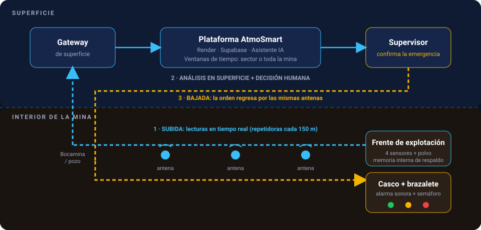

# Arquitectura Física y Comunicación Bidireccional

> _"Cada frente con aire seguro, cada turno con alertas a tiempo."_

En una mina subterránea real, tender fibra óptica o cableado físico hasta los frentes de avance es vulnerable a derrumbes y al propio avance de la explotación. Además, detener toda la mina por un pico aislado de gas de un segundo es operativamente inviable. **AtmoSmart** resuelve ambos retos mediante una arquitectura inalámbrica bidireccional.

## 🔄 Flujo Operativo en 3 Fases

### 1. Subida: Módulos Inalámbricos con Memoria Local

- **Cero cableado vulnerable:** Pequeños módulos sensores con antenas repetidoras (cada **150 m**) envían mediciones en tiempo real hacia superficie sin depender de fibra óptica.
- **Estratificación en el túnel:** En el frente se ubican 4 sensores por altura: **Techo** ($\text{CO}$), **Zona 2** ($\text{CO}$ y $\text{CO}_2$), **Zona 3** ($\text{CO}$ y $\text{NO}_2$) y **Piso** ($\text{NO}_2$ y $\text{CO}_2$), junto con monitoreo de polvo de carbón.
- **Memoria interna de respaldo:** Si una antena o módulo sufre una caída de comunicación, almacena localmente las lecturas y las retransmite al restablecerse el enlace.

### 2. Análisis en Superficie: Decisión Humana + Cloud + IA

- **Supervisión centralizada:** Un operario fuera de la mina monitorea todas las zonas desde la aplicación web alojada en **Render** con base de datos en **Supabase** (con datos simulados periódicamente en tiempo real para validar escenarios).
- **Análisis por ventana de tiempo:** El sistema evalúa tendencias temporales para distinguir entre un pico pasajero y una emergencia real, permitiendo determinar si el riesgo afecta a **un sector específico** o a **toda la mina**.
- **Asistente Inteligente con IA:** Un chatbot conectado en tiempo real al estado vivo de la mina (consumiendo modelos mediante APIs públicas) interpreta tendencias y apoya la toma de decisiones del supervisor.

### 3. Bajada: Retorno al Casco y Brazalete del Minero

- **Transmisión inversa:** Al confirmarse una emergencia sectorial o general, la orden regresa desde superficie hacia el interior usando las **mismas antenas repetidoras**.
- **Receptor en casco + Manilla/Brazalete:** La señal llega a un dispositivo receptor ubicado en el **casco del minero**, el cual se comunica con un **brazalete o manilla personal** que activa una **alarma sonora** y un **semáforo de color** (Verde, Amarillo o Rojo) indicando al trabajador el estado actual de su frente.

---

## 🛠️ Stack Tecnológico e Infraestructura

| Capa                        | Tecnología / Componente                               | Función                                                                               |
| :-------------------------- | :---------------------------------------------------- | :------------------------------------------------------------------------------------ |
| **Campo (Interior)**        | Nodos sensores + Antenas cada 150 m + Casco/Brazalete | Captura multiparámetro, memoria local y alerta personal al trabajador.                |
| **Frontend**                | HTML5, CSS3, JavaScript (Modo Offline-First)          | Visualización en vivo, mapa esquemático, gestión de alertas y operación sin Internet. |
| **Backend**                 | **Render** (`atmosmart-backend.onrender.com`)         | Procesamiento de telemetría simulada periódicamente y motor de reglas normativas.     |
| **Base de Datos**           | **Supabase**                                          | Persistencia histórica por turno de 8 horas, criterios internos y sincronización.     |
| **Inteligencia Artificial** | APIs públicas de modelos de lenguaje                  | Chatbot conectado en tiempo real a los datos de zonas, sensores y alertas.            |
