# Recorrido por los Módulos de AtmoSmart

La interfaz web está diseñada bajo un enfoque **Offline-First** con control de acceso por roles (_Supervisor de turno_), garantizando operatividad continua incluso si falla la conexión a Internet en bocamina.

## 1. Acceso por Roles y Panel General en Tiempo Real

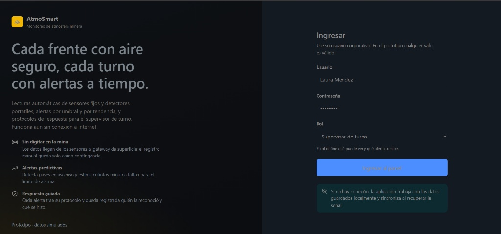

- **Control por roles:** Define qué zonas visualiza y qué alertas recibe cada perfil operativo.
- **Telemetría cada 5 segundos:** El panel principal resume zonas seguras (8/8), alertas sin reconocer, personal expuesto en interior y salud de los 88 sensores instalados.

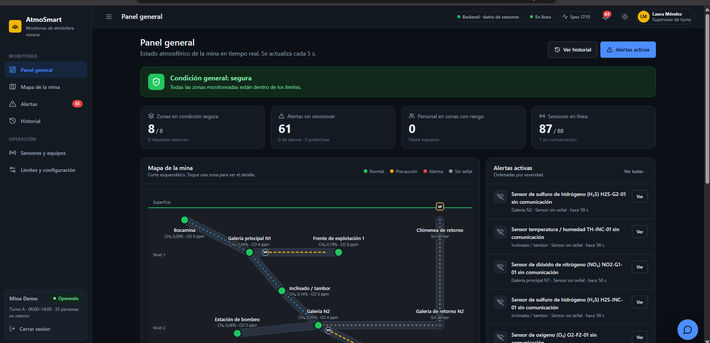

---

## 2. Circuito de Ventilación y Tarjetas por Frente

El mapa esquemático representa el flujo real de aire subterráneo: entrada de aire fresco por **Bocamina**, recorrido por galerías e inclinados, ventilación auxiliar con manga (**VA**) en labores ciegas y extracción por **Chimenea de retorno** mediante el **Ventilador Principal (VP)**.

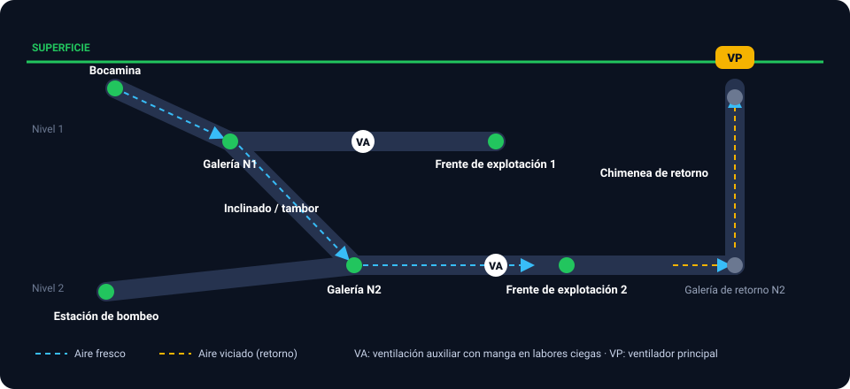

Cada una de las 8 zonas cuenta con su tarjeta individual con lectura de $\text{O}_2$, $\text{CH}_4$, $\text{CO}$, gráfica de tendencia de metano de la última hora y conteo de trabajadores presentes.

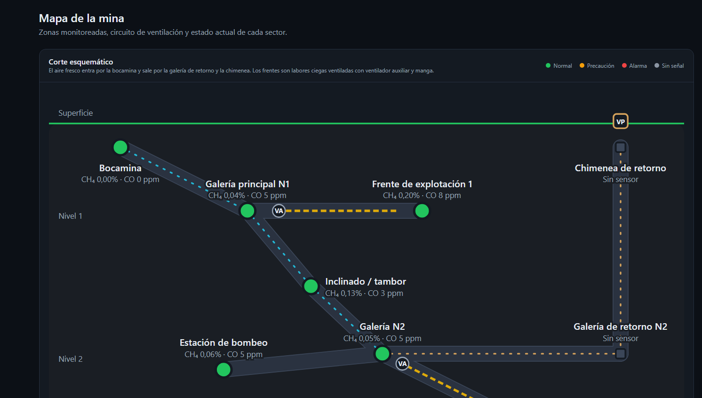

---

## 3. Matriz Multiparámetro y Asistente Inteligente

La vista tabular consolida **14 variables simultáneas** por sector ($\text{O}_2$, $\text{CH}_4$, $\text{CO}$, $\text{CO}_2$, $\text{H}_2\text{S}$, $\text{NO}$, $\text{NO}_2$, $\text{SO}_2$, temperaturas $T_E, T_S, T_H$, humedad relativa $HR$, velocidad del aire $V$ y polvo respirable en $\text{mg/m}^3$).

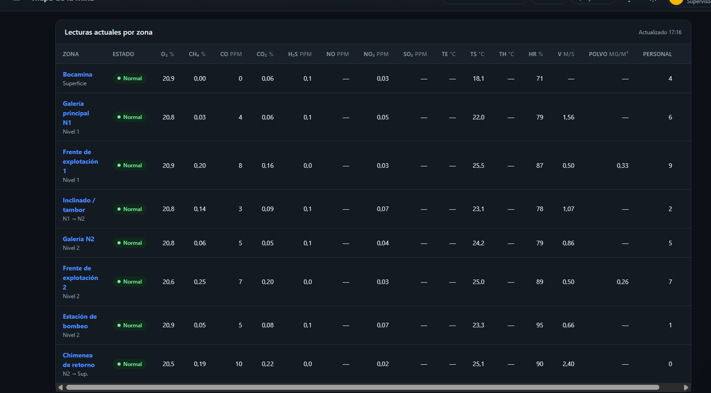

El **Asistente AtmoSmart** consulta en tiempo real esta información desde el backend para responder preguntas operativas en lenguaje natural sin reemplazar los protocolos oficiales.

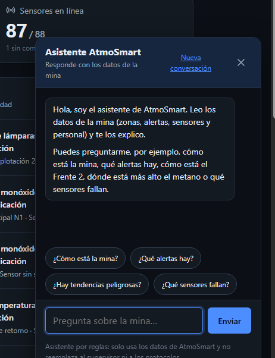

---

## 4. Gestión de Alertas, Historial y Salud de Sensores

- **Alertas auditables:** Clasificación en _Alarma_, _Precaución/predictivas_, _Sin señal_ y _Mantenimiento_ (calibración vencida), con botones de **Protocolo** y **Reconocer**.
- **Historial persistido en Supabase:** Resumen estadístico del turno de 8 horas (promedios, mínimos y máximos) con exportación directa a **CSV**.

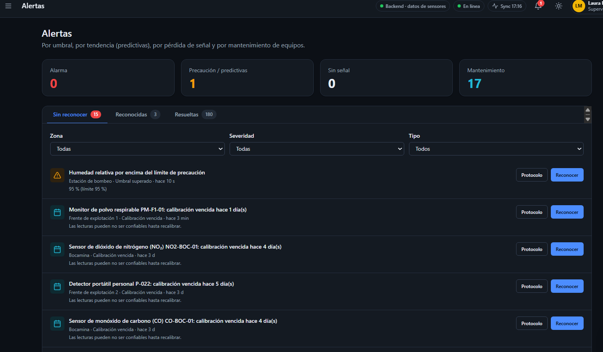

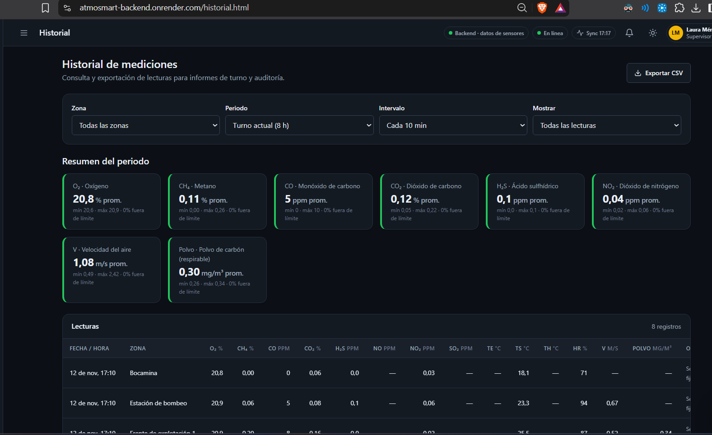

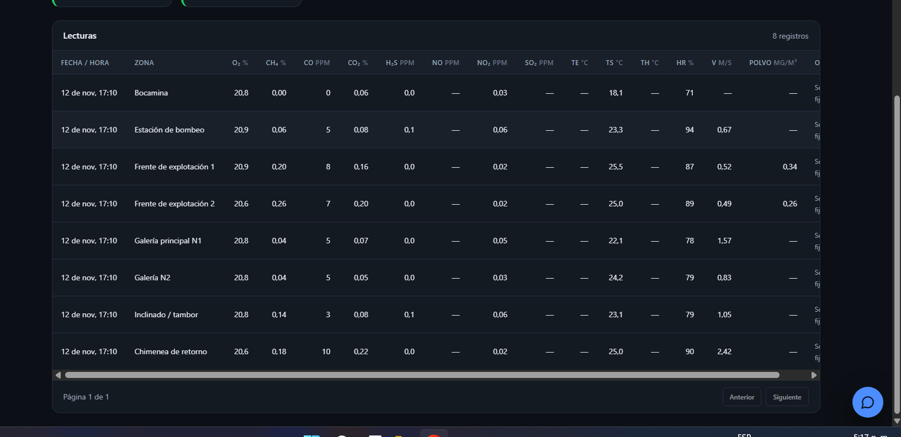

- **Inventario y salud de hardware:** Trazabilidad de batería, última comunicación (cada 3 s) y días de vigencia de calibración para anemómetros y detectores multigas.

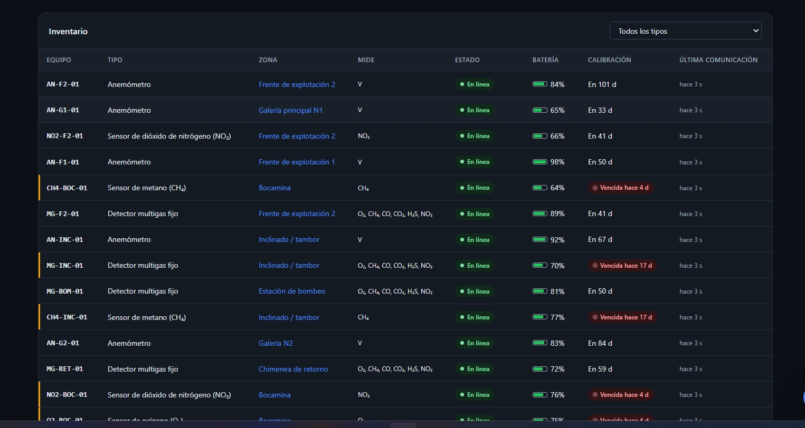

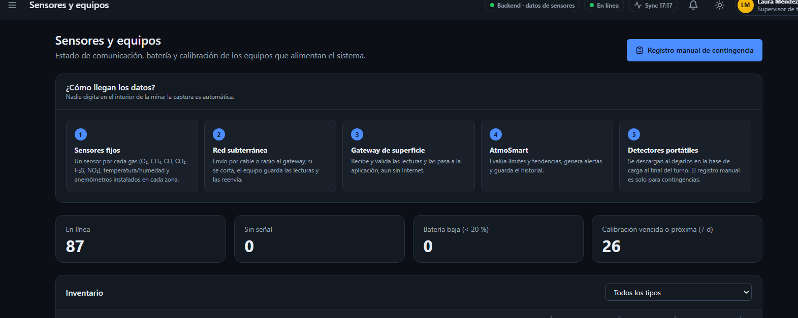
