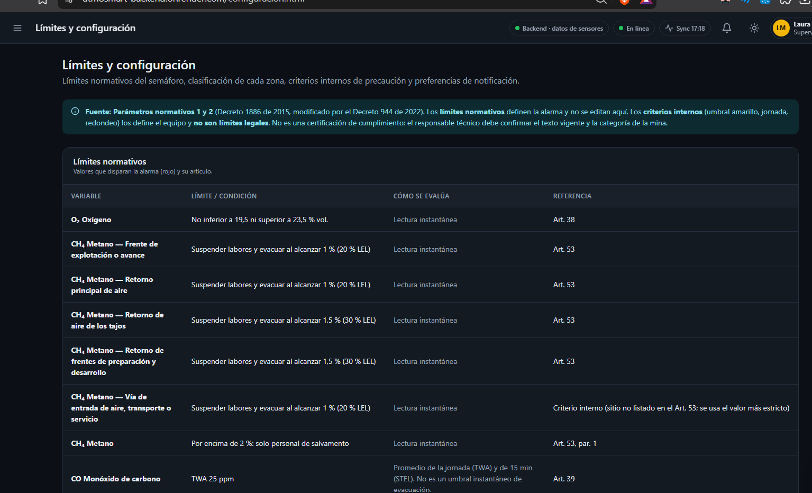
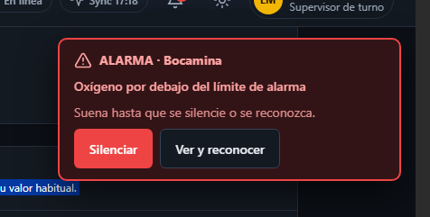

# Motor Normativo y Ergonomía de Alertas

AtmoSmart separa estrictamente los **límites legales inmutables** (Decreto 1886 de 2015, modificado por el Decreto 944 de 2022) de los **criterios operativos internos** configurables en **Supabase**.

## ⚖️ Límites Legales que Disparan Alarma (Rojo)

| Variable                                               | Límite / Condición Legal                                                            | Evaluación                | Referencia        |
| :----------------------------------------------------- | :---------------------------------------------------------------------------------- | :------------------------ | :---------------- |
| **$\text{O}_2$ Oxígeno**                               | No inferior a **19,5 %** ni superior a **23,5 %** vol.                              | Lectura instantánea       | Art. 38           |
| **$\text{CH}_4$ Metano (Frentes / Retorno principal)** | Suspender labores y evacuar al alcanzar **1,0 %** (20 % LEL)                        | Lectura instantánea       | Art. 53           |
| **$\text{CH}_4$ Metano (Tajos / Desarrollo)**          | Suspender labores y evacuar al alcanzar **1,5 %** (30 % LEL)                        | Lectura instantánea       | Art. 53           |
| **$\text{CH}_4$ Metano (Crítico)**                     | Por encima de **2,0 %**: solo cuadrillas de salvamento                              | Lectura instantánea       | Art. 53, par. 1   |
| **$\text{CO}$ Monóxido de carbono**                    | **TWA 25 ppm**                                                                      | Promedio jornada / 15 min | Art. 39           |
| **$\text{CO}_2$ Dióxido de carbono**                   | **TWA 5.000 ppm** · **STEL 30.000 ppm**                                             | Promedio jornada / 15 min | Art. 39           |
| **$\text{H}_2\text{S}$ Ácido sulfhídrico**             | **TWA 1 ppm** · **STEL 5 ppm**                                                      | Promedio jornada / 15 min | Art. 39           |
| **$\text{SO}_2$ Dióxido de azufre**                    | **STEL 0,25 ppm**                                                                   | Promedio 15 min           | Art. 39           |
| **$\text{NO}$ / $\text{NO}_2$**                        | **NO: TWA 25 ppm** · **NO₂: TWA 0,2 ppm**                                           | Promedio jornada / 15 min | Art. 39           |
| **Temperatura efectiva ($T_e$)**                       | $T_e = 0,7 \cdot T_h + 0,3 \cdot T_s - V$ (28 °C sin límite; 32 °C solo salvamento) | Reducción de jornada      | Arts. 217 y 218   |
| **Polvo de carbón**                                    | Precaución **0,5 mg/m³** · Alarma **0,9 mg/m³**                                     | Lectura instantánea       | Criterio interno  |
| **Calidad de sensores**                                | Lectura ausente o calibración vencida = _"No disponible"_ (nunca seguro)            | Auditoría continua        | Arts. 46, 51 y 52 |

---

## 🔔 Ergonomía Sonora y Notificaciones al Operario

- **Alerta Preventiva (Amarilla):** Dos tonos suaves y calmados con una vibración corta (una sola vez) para advertir acercamiento a umbrales sin fatigar al operador.
- **Alarma Crítica (Roja):** Tarjeta flotante persistente con sirena continua de emergencia (barrido agudo-grave de alto impacto) que **suena sin detenerse hasta pulsar "Silenciar"**, manteniendo el incidente activo hasta ejecutar **"Ver y reconocer"** (o escalándolo automáticamente a **HSE** si transcurren 5 minutos sin atención).
